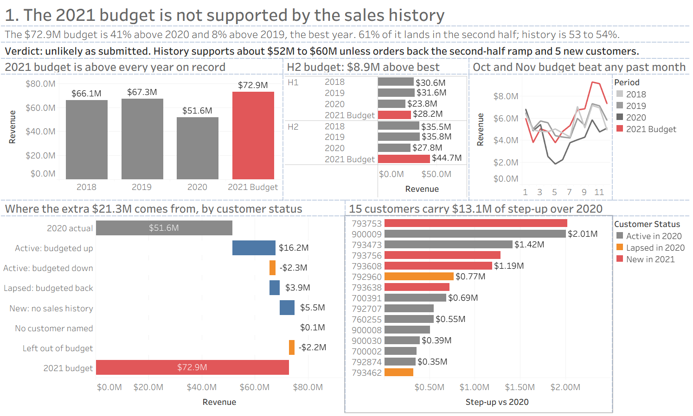
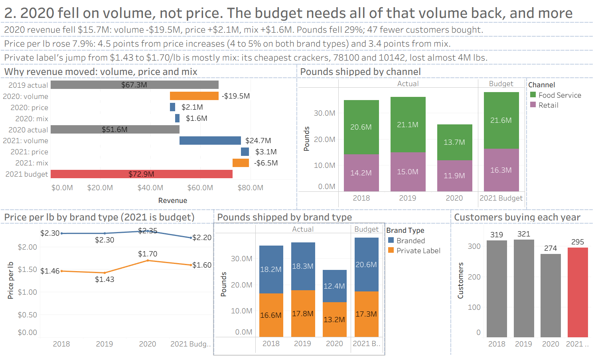
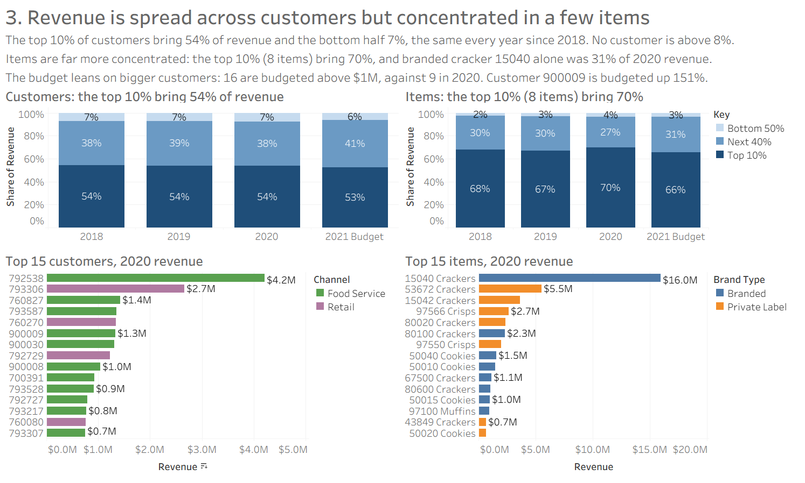
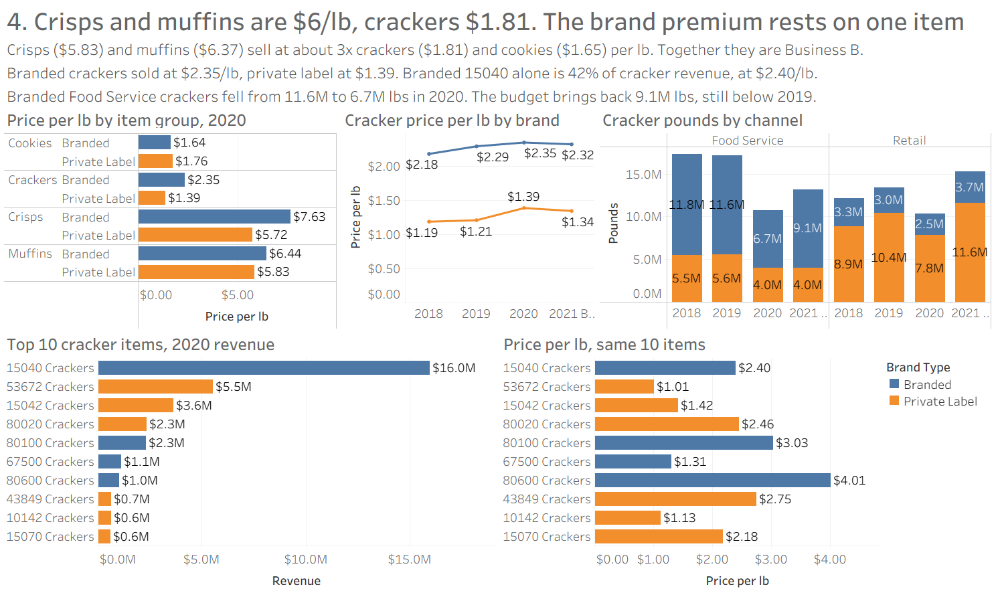
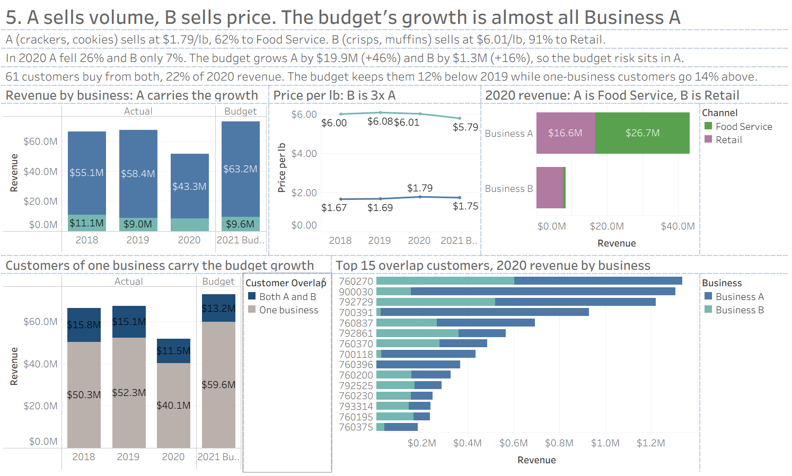
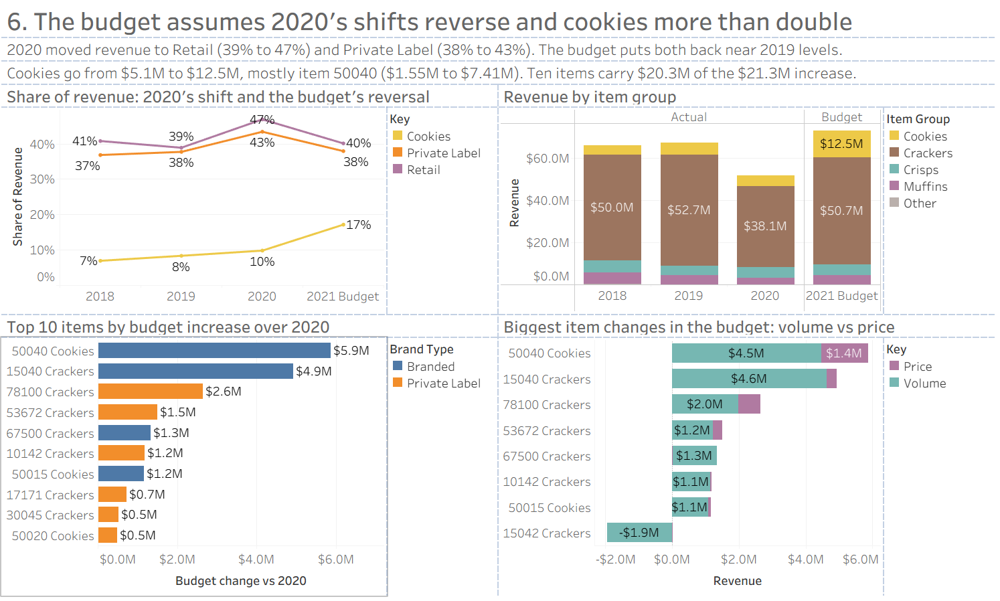
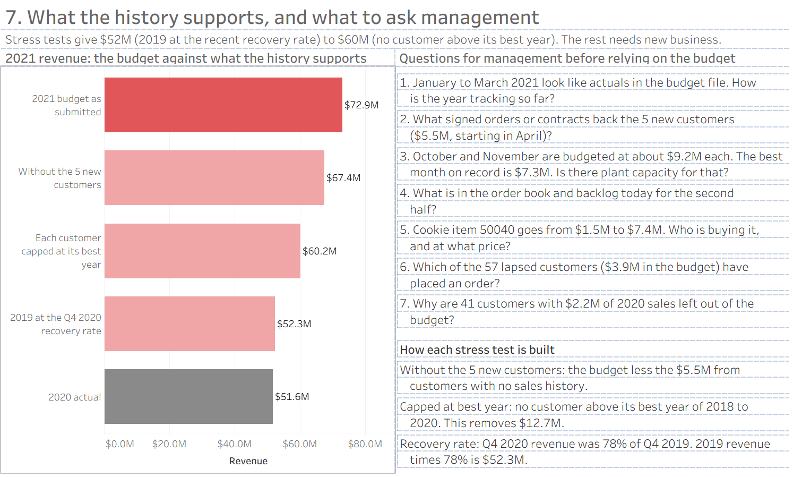

# 2021 Budget Assessment: a data analytics case study

A take-home case study for an analytics engineering role. A lender asked whether a ~$70M snack and baked goods company can hit its 2021 budget, and how the company should automate its sales and budget reporting.

I cleaned and modeled three years of sales history, the 2021 budget and an item weight file in Python, built seven Tableau dashboards, and wrote up the findings and a reporting architecture for the company's CEO and CFO.

The client data was anonymized by the firm that set the case, and it is not included in this repo.

## The answer

**The $72.9M budget is unlikely as submitted. The sales history supports about $52M to $60M.**

- The budget is 41% above 2020 ($51.6M) and 8% above 2019 ($67.3M), the best year on record.
- 2020 was a volume problem, not a pricing problem: pounds fell 29% while prices rose 4 to 5%.
- The budget's risk sits in a few places: 61% of the year lands in the second half, $5.5M comes from 5 customers with no sales history, and ten items carry $20.3M of the $21.3M increase over 2020.

| Scenario | 2021 revenue | How it is built |
|---|---:|---|
| Budget as submitted | $72.9M | The company's forecast |
| Without the 5 new customers | $67.4M | Budget less the $5.5M from customers with no sales history |
| Each customer capped at its best year | $60.2M | No customer above its best year of 2018 to 2020 |
| 2019 at the recent recovery rate | $52.3M | Q4 2020 revenue was 78% of Q4 2019, so 2019 revenue x 78% |

## Dashboards

### 1. The 2021 budget is not supported by the sales history


### 2. 2020 fell on volume, not price


### 3. Revenue is spread across customers but concentrated in a few items


### 4. Crisps and muffins are $6/lb, crackers $1.81. The brand premium rests on one item


### 5. Business A sells volume, Business B sells price


### 6. The budget assumes 2020's shifts reverse and cookies more than double


### 7. What the history supports, and what to ask management


## What is in this repo

| Path | What it is |
|---|---|
| [`deliverables/Case Study Write-up.pdf`](deliverables/Case%20Study%20Write-up.pdf) | 9-page write-up answering the five analytical and four architecture questions (also as `.docx`) |
| [`deliverables/Dashboards.pdf`](deliverables/Dashboards.pdf) | The seven dashboard pages |
| [`docs/architecture.md`](docs/architecture.md) | Reporting architecture: automation, a small-data stack, a billions-of-rows stack, and a 90-day rollout |
| `screenshots/` | Dashboard captures |
| `scripts/` | The pipeline, below |

## How it was built

1. **Load.** `load.py` reads the three Excel extracts. `profile.py` and `profile2.py` were the first look at their shape and quality.
2. **Model.** `build_model.py` cleans the files into a star schema: sales and budget fact tables that share item, customer and date dimensions. It turns item and customer codes into one text key (the budget zero-pads them, sales does not), maps channel and brand labels to one list, unpivots the budget from month columns to rows, and picks one weight per item.
3. **Analyze.** `analyze1.py` and `analyze2.py` answer the case questions and print the numbers behind the findings.
4. **Export.** `export_for_tableau.py` writes three CSVs for Tableau: sales and budget rows, a customer table, and pre-calculated exhibits (price, volume and mix bridges, revenue tiers, stress tests).
5. **Build the workbook in code.** `build_workbook.py` generates the Tableau workbook XML from Python: 29 sheets and 7 dashboards, with calculated fields, colors and layout defined in code. `package_twbx.py` packages it with its data as a `.twbx`.
6. **Check and write up.** `snap.ps1` opens a workbook in its own Tableau instance and captures the dashboard for review. `make_submission_doc.py` builds the Word write-up.

**Price, volume and mix.** Volume is the change in pounds, valued at the earlier period's average price per lb. Price is each item's change in price per lb, on items sold in both periods, valued at the new pounds. Mix is the remainder: the shift between items, plus new and dropped items.

## Rebuilding

Needs Python 3.11 with `pandas`, `numpy` and `openpyxl` (`python-docx` for the write-up), and Tableau Desktop 2026.2 or later. Put the three original Excel files in `materials/`, then from `scripts/`:

```
python build_model.py ../materials ../model
python export_for_tableau.py ../materials ../tableau/data
python build_workbook.py <full path to the tableau folder> 2 case_study.twb
python package_twbx.py <full path to the tableau folder> case_study.twb case_study.twbx
```

Tools: Python (pandas) for cleaning, modeling and analysis; Tableau for the dashboards.
