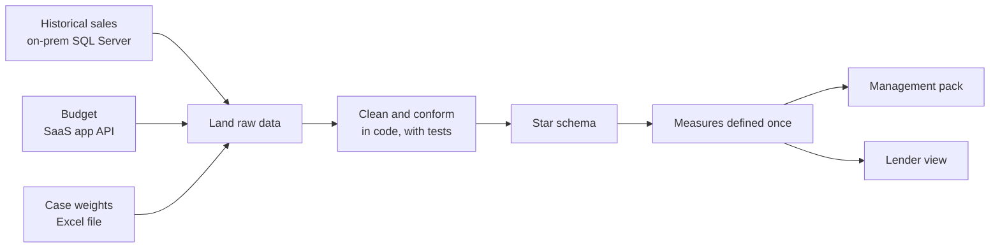

# Reporting Architecture Recommendations

## Summary

Replace the three manual extracts with one scheduled pipeline that lands, cleans and models the data, then feeds a single set of reports. At today's volume this is a small cloud SQL database and a BI tool, not a big data platform.

The model does not change if volume grows. Only the engine underneath it does.

The sample data shows why this matters. Each problem below had to be fixed by hand before any number in the analysis could be trusted.

| Problem found in the extracts | Size | What the pipeline must do |
| --- | --- | --- |
| Budget item codes are zero-padded (00642) and sales codes are not (642) | Every budget row for those items fails to match | Normalize codes on load, then enforce one item master |
| Channel labels differ: "Retail Private Label" is in sales but not in budget | Sales and budget cannot be compared by channel as delivered | One channel list shared by both systems |
| Brand labels differ: "PL" in one file, "Private Label" in another | All private label rows | Map to one value on load |
| Case weights are rounded to 1 decimal in the weight file and 2 in sales | Shifts pounds and price per pound wherever the two weights differ | One governed weight per item, stored at full precision |
| Items with no usable weight (2291, 2292 missing; 97554 is zero; 97519 is zero in sales) | The two zero-weight items cover 298 sales rows, about $250K | Block any item sold without a weight above zero |
| Budget rows with no customer | 3 rows, $106K | Reject on load and send back to the budget owner |
| One customer code ships to 48 states | Customer 760261 | Split bill-to from ship-to in a customer master |
| Zero-dollar and negative lines mixed with sales | 2,899 zero-dollar lines, 6 negative | Tag returns, samples and free goods as their own line types |

One assumption to confirm with the client: January to March 2021 budget values look like actuals, not plan. If so, the budget file is already a forecast and should be versioned as one.

## Question 1: How to automate historical sales and budget reporting

Build one pipeline that pulls all three sources on a schedule, applies the cleaning rules as code, loads a star schema, and refreshes the reports. Nobody exports a file or pastes into Excel.

Three sources feed one nightly run, and both reports read the same tested model.

**How each source gets in**

| Source | Today | Automated |
| --- | --- | --- |
| Historical sales | Custom app on an on-premises SQL Server, extracted by hand | Nightly incremental pull through a secure gateway, by order date or change tracking |
| Budget | Third-party SaaS budgeting app, exported by hand | Scheduled API pull. Every pull is stored with a version stamp so reforecasts can be compared |
| Case weights | Excel file on an operations manager's desktop | Short term: a locked template in a shared location with validation. Then a governed item table with a named owner |

**What happens between source and report**

1. **Land the raw data unchanged.** Keep every extract as received, so any number can be traced back and reloaded.
2. **Clean and conform in code.** The fixes from this exercise become rules: strip zero padding from item codes, map channel and brand labels to one list, unpivot the budget from 12 month columns to rows, fill weights from the item table.
3. **Load a star schema.** Two fact tables (sales, budget) share three dimensions (item, customer, date). That shared shape is what makes budget versus actual a simple comparison.
4. **Define each measure once.** Revenue, pounds and price per pound (revenue divided by pounds) are defined in one semantic layer, not rebuilt in each report.
5. **Test on every run.** Row counts and revenue totals tie to the source. Unmatched item codes, missing weights and budget rows with no customer stop the load and alert an owner.
6. **Refresh the reports.** A monthly management and lender pack, plus budget versus actual by customer, item and channel.

The prototype behind this analysis already follows these steps. A Python script produces the five tables, and the Tableau workbook reads them.

## Question 2: Tools and architecture if volume stays about the same

Keep it small: a managed cloud SQL database as the warehouse, a light scheduler to move the data, SQL for the transformations, and Power BI on top. The sample holds 17,132 sales rows for three years, so a full reload takes seconds.

| Layer | Recommendation | Why |
| --- | --- | --- |
| Ingestion and scheduling | Azure Data Factory, or Fabric Data Factory | Has a gateway to on-premises SQL Server and a REST connector for the budget API. Three small pipelines |
| Storage | Azure SQL Database, smallest practical tier | The client already runs SQL Server, so the skills and the SQL dialect carry over |
| Transformation | SQL views or dbt Core, kept in version control | Cleaning rules are readable, reviewed and tested, not hidden in a workbook |
| Semantic model and reports | Power BI, import mode, scheduled refresh | The whole dataset fits in memory. Measures are defined once and reused |
| Data quality | Tests in the pipeline, with email or Teams alerts | Catches a bad code or a missing weight before a report goes out |

**Why this and not something larger**

- **The data is tiny.** A Spark cluster, a lakehouse or streaming would add cost and moving parts with no benefit at this size.
- **It fits the people.** A finance or IT analyst who knows SQL can run and change it. No specialist data engineer is needed day to day.
- **Running cost is low.** Every piece is pay-as-you-go at its smallest tier. Exact pricing should be confirmed against the client's Microsoft agreement.
- **It can grow.** The star schema and the measure definitions carry over unchanged if the engine is replaced later.

**Assumptions.** I chose the Microsoft stack because the sales system is SQL Server, so the skills and the SQL dialect carry over. The model is tool-agnostic. The prototype for this case reads the same five tables in Tableau.

**A cheaper option, and its cost.** Power BI dataflows alone could do the extraction and cleaning with no database. I would not start there, because the business logic then lives inside the BI tool, where it is harder to test, reuse and audit.

## Question 3: Tools and architecture if shipped orders reach billions of rows per month

Move to a cloud lakehouse or a scale-out cloud warehouse, load changes continuously, and serve reports from pre-aggregated tables. The star schema and the measures stay the same.

A single SQL database and a nightly full reload stop working at this size. Loads run past their window, and a query that scans raw order lines no longer returns in time for a dashboard.

| Layer | What changes | Why |
| --- | --- | --- |
| Ingestion | Change data capture or event streaming from the order system | Only new and changed rows move. A nightly full extract of billions of rows would not finish |
| Storage | Columnar files (Parquet or Delta) on cloud object storage, partitioned by ship date, in raw, clean and curated layers | Cheap at scale, and a query reads only the months and columns it needs |
| Compute | A distributed engine: Microsoft Fabric or Azure Databricks to stay on Microsoft, or Snowflake or BigQuery | Storage and compute scale separately. Compute can be sized up for a load, then paused |
| Transformation | Incremental only: each run processes new partitions | Rebuilding history every night is too slow and too expensive |
| Serving | Aggregate tables at the grain reports use (day, customer, item), with drill-down to detail on demand | Dashboards read millions of rows, not billions, and stay fast |
| Operations | Orchestration, monitoring, data quality checks and cost alerts as standard | At this size a failed load or a runaway query costs real money |

**Three points for the CEO and CFO**

- **Cost becomes a design choice.** Partitioning, auto-pause and moving old data to cheaper storage tiers decide the monthly bill.
- **The source system is the first constraint.** An on-premises custom app writing billions of rows per month would need its own re-architecture, ahead of the reporting.
- **The team changes.** This needs dedicated data engineering, either in-house or as a managed service.

**How I would choose the vendor.** On three things: the skills the team already has, existing vendor contracts, and whether the workload is mostly SQL reporting or also data science. I would run a proof of concept on one month of real data before committing.

## Question 4: Other recommendations for automating reporting

Fix the master data first. Most of the manual work in this exercise came from codes and labels that did not match, not from missing technology.

- **One item master and one customer master.** Each item has one code, one weight, one item group and one brand type. Each customer has a parent and its ship-to locations. Sales and budget both read from these.
- **Budget rules at entry.** Every budget row names a customer and an item that exist in the masters. Three rows worth $106K had no customer.
- **Version the budget.** Keep each budget and reforecast with its date. Then forecast accuracy can be measured, and actuals inside the budget file are visible.
- **Automate the variance.** Produce price, volume and mix variance against budget and prior year every month. The same split explained 2019 to 2020: volume down $19.5M, price up $2.1M, mix up $1.6M.
- **Alert on exceptions.** Flag customers behind budget pace, and new-customer revenue that has not appeared. The 2021 budget has $5.5M from five customers with no sales history.
- **Name an owner for each data set.** Quality alerts go to a person, not a shared inbox. This also removes the dependence on one manager's desktop file.
- **Control access and change.** Row-level security separates the lender view from the management view. Logic sits in version control with separate test and production environments.
- **Add the data the extracts lack.** Open orders and backlog, cost and margin, and plant capacity. A budget that needs a record second half cannot be judged on shipped sales alone.

**Suggested rollout**

1. **First 30 days.** Agree the item, customer and channel lists. Move the case weight file to a controlled location. Stand up the database and load history.
2. **Days 31 to 60.** Automate the sales and budget pulls. Put the cleaning rules and quality tests in code. Release the budget versus actual report.
3. **Days 61 to 90.** Add the monthly variance pack, exception alerts and lender view. Hand over with documentation and a named owner for each data set.
